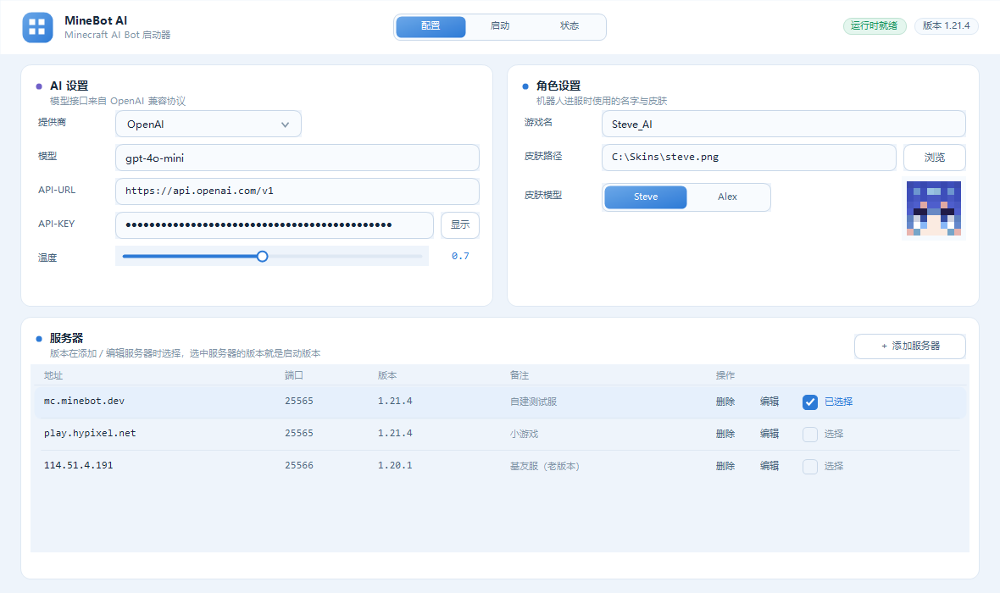
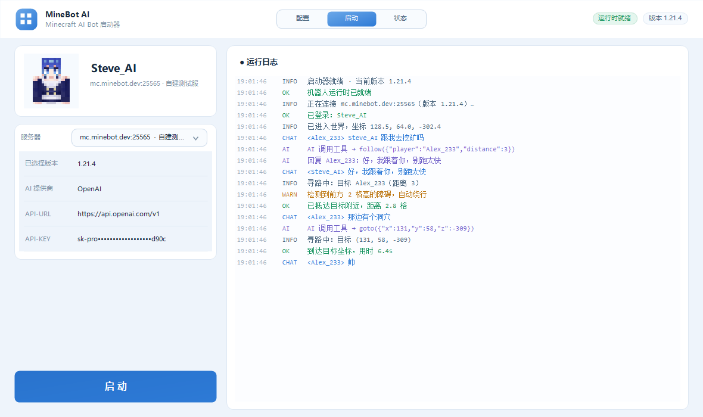
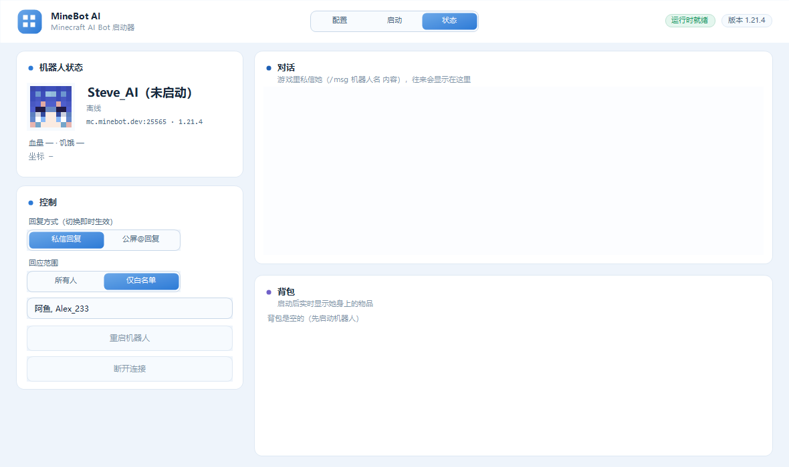

# MineBot AI · 大肥鱼启动器

> 给 **DeepseekOVO（鲸鲸）** 做的原生 Windows 启动器：一个 exe，零依赖，不用装 Node、不用 npm、不用浏览器。

> **声明**：本项目由 **DeepSeek** 辅助生成 —— 代码、界面与文档在 AI 协作下完成，需求、测试与验收由人工负责。



---

## 这是什么

**DeepseekOVO** 是一个运行在 Node 上的 Minecraft AI 玩伴项目（作者是 B 站 UP 主「啊这O_o」，可在 B 站搜索该账号）。本项目给它套了一个 **C# / WinForms 手写界面**，并把整个 OVO 项目（含它自带的 Node 运行时和依赖，约 938 MB）**压进同一个 exe**，首次运行时自动解压。

启动器负责：界面、配置、进程管理、把 OVO 的对话 / 状态 / 背包数据接过来显示。
机器人怎么玩、怎么说话、怎么决策，**全是 OVO 原来的逻辑**。

| 启动页 | 状态页 |
|---|---|
|  |  |

---

## 功能

### 三页界面

| 页面 | 作用 |
|---|---|
| **配置** | AI 提供商 / 模型 / API-URL / API-KEY / 温度；游戏名、皮肤、Steve·Alex 模型；服务器增删改选（版本在添加时选） |
| **启动** | 角色立绘、已选版本、AI 信息、启动按钮；实时机器人日志 |
| **状态** | 连接状态、血量 / 饥饿 / 坐标 / 游戏模式、图形化背包、私信对话记录、回复方式、白名单、重启 / 断开 |

### 可控的对话行为

| 功能 | 说明 |
|---|---|
| **回复方式** | 私信回复 / 公屏@回复，切换即时生效 |
| **白名单** | 只回应指定玩家（逗号分隔），其余静默忽略 |
| **文件桥** | OVO 把对话、状态、背包推给启动器显示，不依赖 stdout |

### 单文件运行

exe 内嵌：OVO 完整项目、861 个可联机版本清单、默认皮肤。

首次启动在 exe 旁边解压 `MineBotData\`（约 940 MB，2~3 分钟，只此一次）：

```
MineBotData\
├── config.json     启动器配置（AI / 角色 / 服务器）
├── ovo\            DeepseekOVO 完整项目（自动解压 + 自动打补丁）
│   ├── main.js  settings.js  keys.json  runtime\node.exe  src\
│   ├── reply-mode.txt      whisper | public
│   ├── respond-scope.txt   all | whitelist
│   ├── whitelist.txt       白名单玩家
│   └── bridge.log          推给启动器的真实数据
└── skin\           皮肤
```

---

## 构建

需要：

- Windows + .NET Framework 4.8（系统自带 `csc.exe`，不用装 SDK）
- 一份 **DeepseekOVO 完整版**（含它自己的 `runtime\node.exe`）

```powershell
# 1) 把 OVO 项目打成 ovo-payload.zip（约 217 MB，放在仓库上一级目录）
.\make-ovo-payload.ps1 -OvoDir "D:\DeepseekOVO-公开版"

# 2) 编译单文件 exe（产物 McBotLauncher.exe，约 217 MB）
.\pack.ps1
```

> `ovo-payload.zip` 不进仓库（217 MB + 第三方项目），所以要先自己生成。

命令行开关：

```powershell
McBotLauncher.exe --shot out.png --page status   # 渲染截图
McBotLauncher.exe --ensure-ovo                   # 只解压 OVO
McBotLauncher.exe --patch-ovo                    # 只给 OVO 打补丁
McBotLauncher.exe --selftest                     # 逻辑自检
```

---

## 对 OVO 做的改造（只改 4 处，玩法逻辑一行没动）

源码里带 `[启动器补丁]` 标记，由 `src/OvoPatcher.cs` 在**每次启动时自动检查并补齐**（幂等，重新解压也不会丢）：

| 改动 | 实现 |
|---|---|
| **私信 / 公屏@ 两种回复方式** | 在 `openChat` 出口读取 `reply-mode.txt`，决定 `bot.whisper()` 还是 `bot.chat('@玩家 …')` |
| **白名单过滤** | 在 `respondFunc` 最前面读取 `respond-scope.txt` / `whitelist.txt`，名单外直接 return |
| **去掉网页面板** | 注释掉 mindserver 的 `express.static`，端口只当内部总线 |
| **数据回传** | 拦一层 `console.log`，把 `DATA|` 行同时写进 `bridge.log`，启动器每 600ms 增量读取 |

启动前启动器还会自动写 OVO 的配置：`settings.js`（地址 / 端口 / 版本）、`keys.json`（API Key）、`andy.json`（游戏名），端口用 `MINECRAFT_PORT` 环境变量传入，并关掉它自动弹浏览器。

---

## 快速开始（给最终用户）

1. 双击 `McBotLauncher.exe`，等首次解压完成
2. 配置页填 AI 信息（DeepSeek：`https://api.deepseek.com/v1` + API Key）
3. 添加服务器（地址、端口、版本）
4. 启动页点「启动」
5. 游戏里 `/msg 机器人名字 你好` —— 默认只回私信

---

## 目录结构

```
src/
├── Program.cs        入口（--shot / --selftest / --ensure-ovo / --patch-ovo）
├── MainForm.cs       主窗口、服务器编辑、启动流程、文件桥轮询
├── Screens.cs        配置页 + 启动页
├── StatusPage.cs     状态页（对话 / 背包 / 回复方式 / 白名单）
├── Controls.cs       自绘控件（卡片/按钮/输入框/滑块/表格/日志/背包）
├── Theme.cs          浅蓝主题
├── VersionDialog.cs  版本选择弹层
├── Versions.cs       版本清单 + OVO 进程管理
├── Runtime.cs        内嵌资源解压（OVO 包、长路径、tar 加速）
├── OvoPatcher.cs     给 OVO 源码打补丁（本项目核心）
├── Model.cs          配置模型
└── SelfTest.cs       逻辑自检
assets/               默认皮肤
data/                 版本清单
shots/                README 截图
```

---

## 致谢

- **B 站 UP 主「啊这O_o」**（B 站搜索该账号即可，作者没有公开代码仓库）—— 机器人内核 **DeepseekOVO（鲸鲸）** 出自他之手：人格设定、说话风格、采集 / 挖矿 / 建造 / 合成、记忆与自主模式，全部来自该作品；默认皮肤 `Deepseek_Chan.png` 也来自其中。本项目只做界面、打包、私信化与数据回传。
- [mineflayer](https://github.com/PrismarineJS/mineflayer) 及 PrismarineJS 生态
- Mojang 的 `version_manifest_v2.json`

---

## 已知限制

- 离线登录：服务器看到的皮肤是默认的
- 首次解压占约 940 MB
- 去掉了 OVO 网页面板，所以「多机器人 / profile 上传 / Apply&Restart」不可用
- 版本清单是本地快照，Mojang 出新版本要重新打包

---

## 关于本项目

- **AI 辅助**：本项目由 **DeepSeek** 辅助生成。需求提出、方向决策、运行验证由作者完成；代码实现、界面打磨、问题排查与文档撰写在 AI 协作下完成。
- **与 DeepseekOVO 的关系**：只是"启动器 + 打包 + 补丁"的外壳，机器人内核与人格设定归原作者（B 站「啊这O_o」）所有，本项目不主张其代码的任何权利。

## 免责声明

仅供个人学习与娱乐。请确认你接入的服务器允许机器人登录，勿用于刷屏、骚扰或破坏他人游戏体验。使用后果自负。
